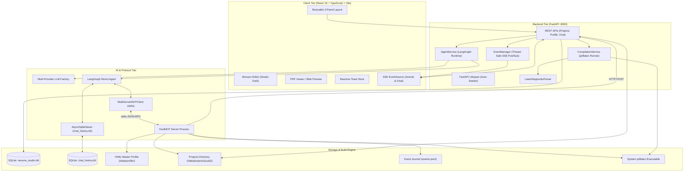

# AI Resume Studio

<div align="center">


**An AI-assisted LaTeX resume engineering studio with project-based versioning, persistent profile management, autonomous self-healing compilation, and real-time multi-panel synchronization.**

[](https://fastapi.tiangolo.com)
[](https://react.dev)
[](https://www.typescriptlang.org)
[](https://langchain-ai.github.io/langgraph/)
[](https://modelcontextprotocol.io)
[](https://tailwindcss.com)
[](LICENSE)

</div>

---

## Overview

Tailoring resumes for different software engineering roles is often tedious, error-prone, and frustrating. Editing raw LaTeX manually can cause catastrophic build errors from a single unescaped ampersand (`&`), while standard web chatbots lack local compile-and-test loops.

**AI Resume Studio** bridges the gap between deterministic, publication-grade LaTeX typesetting and modern agentic AI. It provides an all-in-one developer workspace where an intelligent AI assistant inspects your code, injects details from your canonical profile, writes clean LaTeX, and automatically compiles the PDF—iteratively fixing its own syntax errors if compilation fails.

---

## Key Features

- **Three-Panel Interactive Workspace**:
  - Live PDF viewer with dynamic object URL updates and zero-refresh rendering.
  - Full-featured **Monaco Editor** with custom Studio-Dark syntax theming, keyboard shortcuts (`Ctrl+S` / `Cmd+S`), and inline compiler diagnostics.
  - Streaming AI assistant chat panel with real-time tool execution tracking.
- **Closed-Loop Autonomous AI Agent**:
  - Built with **LangGraph** (ReAct architecture) connected to a **Model Context Protocol (MCP)** server over secure `stdio`.
  - **Self-Healing Build Loop**: Whenever the AI modifies the resume, it automatically triggers compilation. If TeX errors occur, compiler diagnostics are parsed and returned to the agent loop to self-heal without user intervention.
  - **Fast-Path Turn Completion**: Automatically bypasses redundant LLM round-trips once document updates succeed, slashing latency and token usage.
- **Persistent Multi-Session Chat Memory**:
  - Conversation checkpoints are stored in SQLite (`chat_history.db` with WAL mode) via `AsyncSqliteSaver`, preserving chat history across browser reloads and server restarts.
- **Canonical Master Profile (Single Source of Truth)**:
  - Centralized storage for skills, experience, education, projects, and certifications in human-readable YAML files (`data/profile/*.yaml`).
  - The AI agent selectively reads from your profile when prompting it to add specific projects or skills.
- **Multi-Project Management & 1-Click Duplication**:
  - Manage multiple role-specific resumes (e.g., "Full Stack", "Distributed Systems", "Cloud/DevOps").
  - 1-click duplication clones LaTeX source and compiled PDFs with clean, isolated conversation threads.
- **Real-Time Cross-System Synchronization**:
  - Built-in **Server-Sent Events (SSE)** pipeline broadcasts file updates, compilation states, and agent actions directly to the frontend.
- **Automated First-Run Seeding**:
  - Automatically provisions runtime directories, SQLite tables, sample YAML profiles, and a starter resume project upon first launch.
- **Multi-Provider LLM Support**:
  - Out-of-the-box support for **Google Gemini**, **OpenAI**, **Anthropic Claude**, **Groq**, and **Local Models (Ollama / vLLM)**.
- **Hardened LaTeX Sandbox**:
  - Runs `pdflatex` inside isolated temporary directories with `-no-shell-escape` to prevent malicious or hallucinated command execution.

---

## Architecture

The application is structured into four decoupled layers:



### Architectural Decisions & Trade-offs

| Decision | Rationale | Trade-off |
| :--- | :--- | :--- |
| **Model Context Protocol (FastMCP)** | Standardizes tool definitions over `stdio` JSON-RPC; decouples AI execution from the web server. External coding agents (Claude Desktop, Cursor) can reuse the tools. | Small IPC overhead compared to in-memory Python function calls. |
| **Dual Persistence (SQLite + Filesystem)** | SQLite stores indexed metadata and timestamps; filesystem stores raw `.tex` and `.pdf` files so standard command-line tools (`pdflatex`, Git, external IDEs) work directly. | Requires two-phase commit patterns (`ProjectLifecycleService`) to prevent orphaned disk files. |
| **Persistent SQLite Checkpointer** | Uses `AsyncSqliteSaver` in WAL mode to retain multi-turn agent context across server restarts. | Adds SQLite write operations on agent state changes. |
| **YAML for Master Profile** | Highly readable, human-editable, schema-flexible format supporting multi-line markdown lists and nested categories without database schema migrations. | Requires validation checks on save to prevent YAML syntax corruption. |
| **Server-Sent Events (SSE)** | Unidirectional server-to-client streaming natively supported by browser `EventSource` with auto-reconnection and low protocol overhead. | Client-to-server operations use standard HTTP POST requests rather than bi-directional WebSockets. |

---

## Tech Stack

### Frontend
- **Framework**: React 19, TypeScript
- **Bundler & Tooling**: Vite 8, ESLint
- **Styling**: Tailwind CSS v4, custom Studio-Dark design tokens
- **Code Editor**: `@monaco-editor/react` (Monaco Editor)
- **Layout & Icons**: `react-resizable-panels`, Lucide React
- **Markdown Rendering**: `react-markdown`, `remark-gfm`
- **State & Notifications**: Custom `useSyncExternalStore` Toast system

### Backend & AI
- **API Framework**: FastAPI, Uvicorn (ASGI)
- **Database & ORM**: SQLite, SQLAlchemy 2.0, Alembic
- **AI Agent Framework**: LangGraph, LangChain
- **Protocol**: FastMCP, Model Context Protocol (MCP) via `langchain-mcp-adapters`
- **Checkpointer**: `langgraph-checkpoint-sqlite`, `aiosqlite`
- **Serialization**: PyYAML, Pydantic v2
- **Package Manager**: `uv`

### Document Engine
- **Typesetting**: TeX Live / `pdflatex` with `-no-shell-escape` sandbox execution
- **Diagnostics**: Custom regex-based TeX error and warning parser

---

## Prerequisites

Before running AI Resume Studio, ensure you have the following installed:

1. **Python 3.12+**
2. **Node.js 18+** & `npm`
3. **uv** (Ultra-fast Python package and project manager):
   ```bash
   curl -LsSf https://astral.sh/uv/install.sh | sh
   ```
4. **LaTeX Compiler (`pdflatex`)**:
   - **Debian / Ubuntu**:
     ```bash
     sudo apt update && sudo apt install -y texlive-latex-base texlive-latex-extra texlive-fonts-recommended
     ```
   - **macOS** (via Homebrew / MacTeX):
     ```bash
     brew install --cask mactex-no-gui
     ```
   - **Arch Linux**:
     ```bash
     sudo pacman -S texlive-basic texlive-latexextra
     ```

---

## Installation & Quick Start

### 1. Clone the Repository
```bash
git clone https://github.com/Krishna-3228/ai-resume-studio.git
cd ai-resume-studio
```

### 2. Configure Environment Variables
Copy the example environment configuration:
```bash
cp .env.example .env
```

Open `.env` and set your preferred LLM provider API key (Google Gemini, OpenAI, Anthropic, Groq, or Ollama):
```env
# Example using Google Gemini
GEMINI_API_KEY=your_gemini_api_key_here
LLM_MODEL=gemini-2.0-flash

# Optional: Data directory path (defaults to ./data)
RESUME_DATA_DIR=data
```

### 3. Install & Start Backend
The backend automatically runs first-run seeding to create SQLite tables, profile files, and a starter resume:
```bash
cd backend
uv sync
uv run uvicorn backend.main:app --reload
```
The API server will start at `http://127.0.0.1:8000`.

### 4. Install & Start Frontend
In a new terminal window:
```bash
cd frontend
npm install
npm run dev
```
Open your browser and navigate to `http://localhost:5173`.

---

## Configuration & LLM Providers

The system automatically detects whichever provider key is configured in your `.env` file, or you can explicitly specify `LLM_PROVIDER`:

| Provider | Environment Variables | Default Model | Notes |
| :--- | :--- | :--- | :--- |
| **Google Gemini** | `GEMINI_API_KEY` | `gemini-2.0-flash` | Recommended for speed, quality, and low latency |
| **OpenAI** | `OPENAI_API_KEY` | `gpt-4o` | High reasoning capability |
| **Anthropic** | `ANTHROPIC_API_KEY` | `claude-3-5-sonnet-latest` | Exceptional code generation and formatting |
| **Groq** | `GROQ_API_KEY` | `openai/gpt-oss-120b` | Ultra-fast inference speeds |
| **Ollama / Local** | `LLM_PROVIDER=ollama`<br>`LLM_BASE_URL=http://localhost:11434/v1` | `llama3.2` | Fully private, offline local inference |

---

## User Guide

### 1. Maintain Your Master Profile
- Navigate to the **Profile** tab in the sidebar.
- Edit your canonical information across 6 sections:
  - `personal-info.yaml` (Name, contact, links)
  - `education.yaml` (Degrees, institutions, dates, GPA)
  - `experience.yaml` (Work history, responsibilities, metrics)
  - `skills.yaml` (Languages, frameworks, databases, tools)
  - `projects.yaml` (Personal and commercial projects)
  - `certifications.yaml` (Credentials, verifying links)
- Press `Ctrl+S` / `Cmd+S` or click **Save Section** to persist changes.

### 2. Manage Resume Projects
- From the **Dashboard**, view all resumes, search by role name, or create a new project.
- Use **Duplicate Project** to branch a new resume variation (e.g., tailoring an existing full-stack resume into a backend-heavy resume). The duplicate starts with a fresh chat history while preserving the exact LaTeX code and compiled PDF.

### 3. Work in the Studio Workspace
- Click on any project to enter the 3-panel workspace:
  - **Left**: PDF preview with zoom and instant download.
  - **Center**: Monaco LaTeX code editor with live syntax highlighting and error markers.
  - **Right**: AI Resume Assistant chat interface.
- **Example AI Prompts**:
  - *"Highlight my distributed systems and Kafka experience in the summary and projects."*
  - *"Import my cloud certifications from my master profile and add them to the certifications section."*
  - *"Shorten my experience bullet points so the resume fits cleanly on a single page."*
  - *"Rephrase my project bullet points using the Google XYZ action-verb formula."*
- Click **Recompile** or press `Ctrl+S` anytime to compile the PDF manually.

---

## Development & Testing

### Running Tests

The test suites cover unit and integration testing across API routes, lifecycle management, compilation parsing, seeding, and MCP tools:

```bash
# Run backend test suite (95 tests)
cd backend
uv run pytest

# Run MCP server test suite
cd mcp-server
uv run pytest
```

### Manual Seeding CLI
To manually trigger the database and profile seeding engine from the command line:
```bash
cd backend
uv run backend-seed
```

---

## Project Structure

```
ai-resume-studio/
├── .env.example              # Environment variables template
├── README.md                 # Project documentation
├── backend/                  # FastAPI & Agent backend
│   ├── src/backend/
│   │   ├── db/               # Database engine, session, and seed scripts
│   │   ├── models/           # SQLAlchemy project and event models
│   │   ├── routers/          # FastAPI routers (projects, chat, profile)
│   │   ├── schemas/          # Pydantic request and response schemas
│   │   └── services/         # Agent, compilation, storage, and lifecycle services
│   ├── tests/                # Backend pytest test suite (95 passing tests)
│   └── pyproject.toml        # Backend dependencies managed by uv
├── mcp-server/               # Standalone FastMCP Server
│   ├── src/mcp_server/
│   │   ├── services/         # LaTeX runner, event logger, profile reader
│   │   └── server.py         # FastMCP tool registrations (stdio)
│   └── tests/                # MCP tool unit tests
├── frontend/                 # React 19 + TypeScript frontend
│   ├── src/
│   │   ├── components/       # Layout, navigation, and toast components
│   │   ├── pages/            # Dashboard, Profile, and Workspace pages
│   │   ├── services/         # Axios and SSE client API services
│   │   └── utils/            # Monaco theme and editor configurations
│   ├── package.json          # Frontend dependencies
│   └── vite.config.ts        # Vite configuration
├── data/                     # Local data directory (gitignored)
│   ├── profile/              # Canonical YAML master profile
│   ├── projects/             # Project directories containing resume.tex & resume.pdf
│   ├── events/               # Project JSONL event logs
│   ├── resume_studio.db      # SQLite project metadata database
│   └── chat_history.db       # SQLite AI conversation checkpoint database
└── templates/                # Starter and minimal LaTeX templates
```

---

## Contributing

Contributions are welcome! Please follow these guidelines:
1. Fork the repository and create a feature branch (`git checkout -b feature/amazing-feature`).
2. Run the test suite before committing (`uv run pytest`).
3. Commit your changes with clear, semantic commit messages (`git commit -m 'feat: add amazing feature'`).
4. Push to the branch (`git push origin feature/amazing-feature`) and open a Pull Request.

---

## License

This project is licensed under the MIT License - see the [LICENSE](LICENSE) file for details.
